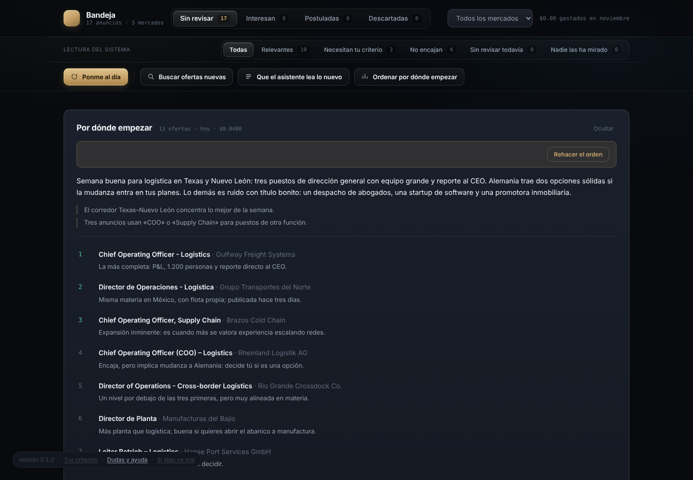
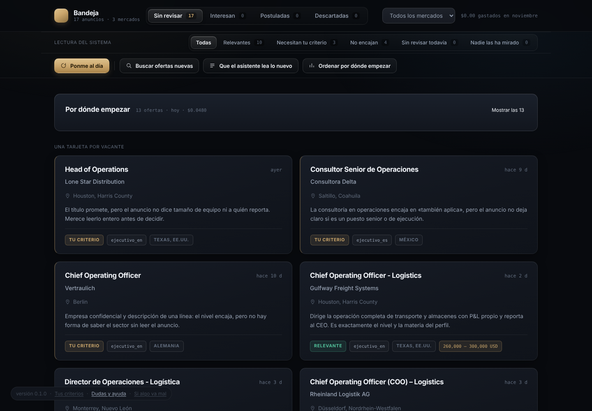
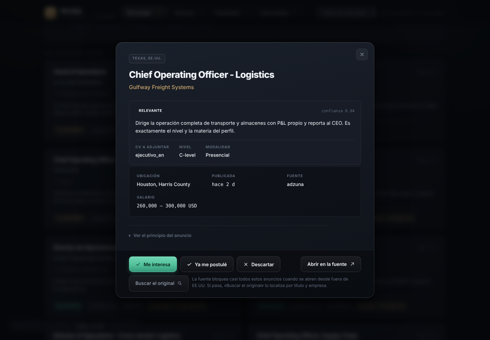
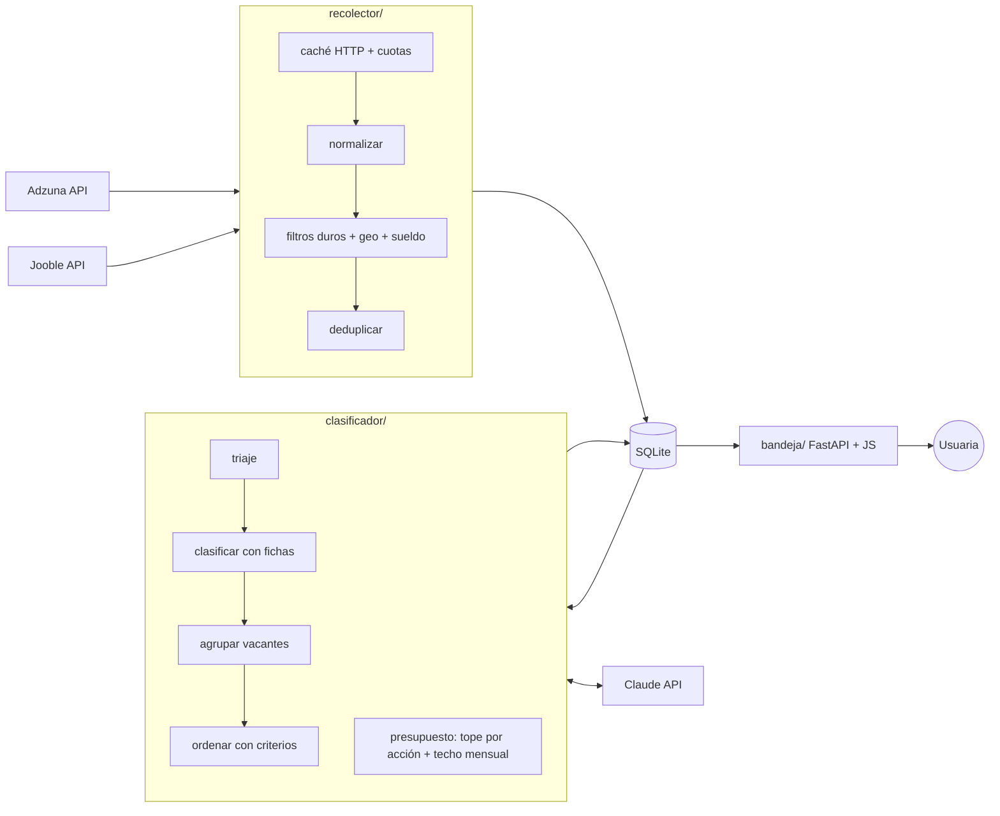

# Job Rob

**Copiloto de búsqueda de empleo para perfiles directivos.** Busca vacantes cada día en varios países, un LLM las lee y explica cuáles merecen la pena y por qué, elige qué CV adjuntar y lo ordena todo en una bandeja de escritorio. La decisión, y la candidatura, siempre las toma la persona.



> **Proyecto real, datos ficticios.** Job Rob se construyó como encargo freelance para una clienta particular y hoy lo usa en su portátil. Este repositorio es la versión pública: el perfil de búsqueda, las fichas de CV, las ofertas y las empresas de la demo son **inventados**. Ningún dato de la clienta ha estado nunca aquí.

<sub>**English summary:** a local job-search copilot for senior executives. It pulls listings from job APIs across Mexico, Texas and Germany, filters them locally, has Claude classify each one against a CV profile (never the CV itself), routes the right CV by ad language, and ranks everything in a FastAPI + vanilla JS inbox with hard per-action spending caps. Python, ~39k lines, 737 offline tests, Windows installer and auto-updater. Built for a real client; all data in this repo is fictional.</sub>

---

## El problema

La clienta, una ejecutiva con más de 20 años de experiencia, buscaba un puesto de dirección en varios países a la vez. A ese nivel el volumen es bajo (unas pocas ofertas buenas por semana), pero están enterradas entre cientos de anuncios con el título correcto y el puesto equivocado: un «COO» de un despacho de abogados, un «Director of Operations» de ciencia de datos, una analista que «reporta al COO».

Lo que pidió al principio era un bot que buscara y se postulara solo. Lo que se construyó es un **copiloto**, y es una decisión deliberada (ver más abajo).

## Qué hace

1. **Recolecta** vacantes de las APIs de Adzuna y Jooble en tres mercados (México, Texas y Alemania) con combinaciones de palabras clave por mercado e idioma.
2. **Filtra en local, gratis**: antigüedad, lista negra y lista blanca de títulos (en español, inglés y alemán), filtro geográfico por estado, condado y zona, y umbral salarial con conversión de divisa.
3. **Agrupa** los anuncios repetidos en vacantes: el mismo puesto publicado en cinco ciudades o por dos marcas de la misma empresa es una sola oportunidad.
4. **Clasifica con un LLM** (Claude, con salida estructurada validada con Pydantic): si es relevante, por qué, con qué confianza, qué nivel tiene y qué CV adjuntar. Por debajo del umbral de confianza no adivina: lo marca como *«necesita tu criterio»*.
5. **Ordena** lo que sobrevive según criterios escritos en lenguaje natural por la propia usuaria, y redacta una lectura de *«Por dónde empezar»*.
6. **Presenta** todo en una bandeja local donde se decide en un clic: *Me interesa*, *Ya me postulé*, *Descartar* o *Abrir en la fuente*.

| Tarjetas por vacante | Ficha de una vacante |
|---|---|
|  |  |

## Decisiones de diseño

**Copiloto, no piloto automático.** LinkedIn, Indeed y Glassdoor prohíben los bots en sus condiciones de uso, y a este nivel una candidatura mal enviada cuesta más que el tiempo que ahorra. La app nunca envía una candidatura: prepara la decisión y la deja a un clic.

**APIs en lugar de scraping.** Adzuna y Jooble tienen APIs públicas con cobertura en los tres países. Jooble da 500 peticiones *de por vida* por clave, así que tiene su propio contador persistente que avisa y se niega a gastar cuando quedan pocas.

**El LLM nunca lee el CV.** Clasifica leyendo una *ficha* (sector, puestos objetivo, palabras clave, qué no encaja) que vive en `config/cvs.yaml`. El CV real se queda en `data/cvs/`, fuera de git, y no sale nunca de la máquina de la usuaria.

**El CV lo decide el idioma del anuncio, no el país.** Una empresa mexicana que publica en inglés espera el CV en inglés. Hay una detección de idioma local y gratuita que se contrasta con la del modelo.

**Lo barato primero, lo caro al final.** Cada oferta que el filtro local tira es una oferta que no gasta tokens. Un *triaje* previo, en una sola llamada barata, decide a qué ofertas merece la pena leerles la descripción completa antes de clasificar.

**El gasto se ve antes de gastar.** Cada botón que cuesta dinero enseña el importe estimado y pide confirmación. Hay un **tope por acción**, que frena, y un **techo mensual**, que avisa, con una cuota aparte para la corrida automática de cada mañana. La API key es de la usuaria, así que los costes son suyos y transparentes. Medido en uso real: unos pocos dólares al mes.

**Caché de clasificaciones con huella.** Una oferta ya clasificada no se vuelve a pagar. Si cambian las fichas de CV, la huella cambia y las clasificaciones se marcan como obsoletas. Si solo cambian los criterios de orden, no: ordenar es barato y reclasificar no.

**Nunca esconder una oferta.** Una vacante que el asistente vio y aplazó se distingue de una que nadie miró. Un tope de gasto deja trabajo pendiente, pero no borra nada.

**Hecho para alguien que no es técnica.** Instalador para Windows en PowerShell, acceso directo con icono generado por código, actualizador que se aplica al abrir, tarea programada opcional, botón de diagnóstico que prepara un informe sin datos personales y una guía de ayuda escrita para ella ([AYUDA.md](AYUDA.md)).

## Arquitectura



| Carpeta | Qué hay |
|---|---|
| `recolector/` | Conectores, caché en disco, control de cuotas, filtros, geografía (estados, condados y zonas), normalización de sueldos y divisas, deduplicación y reporte de la corrida |
| `clasificador/` | Cliente del LLM, esquemas Pydantic, fichas de CV, triaje, motor de clasificación, agrupador, asistente de orden y libro de gastos |
| `bandeja/` | Servidor FastAPI local, trabajos en segundo plano con progreso y cancelación, tarea programada e interfaz en HTML, CSS y JavaScript sin frameworks |
| `herramientas/` | Instalador y actualizador para Windows, comprobación del entorno, corrida diaria y preparación de la entrega |
| `config/` | Todo lo ajustable sin tocar código: perfil de búsqueda, mercados, cuotas, límites de gasto y fichas de CV |
| `tests/` | 737 pruebas que corren sin red ni API keys |

## Pruébalo

Probado con Python 3.13. La demo no necesita API keys ni red, y no gasta nada.

```bash
git clone https://github.com/jpgarcia04/job-rob-portfolio.git
cd job-rob-portfolio
pip install -r requirements.txt

python tools/demo.py      # abre la bandeja con 17 ofertas inventadas
python -m pytest -q       # 737 pruebas, offline
```

La demo pasa sus ofertas por el **pipeline real** (filtros, zonas, deduplicación y guardado) y abre la **bandeja real**. Lo único simulado son los veredictos y el orden, que en producción escribe el modelo leyendo cada anuncio.

Para usarlo de verdad: copia `.env.example` a `.env` con tus claves de Adzuna y Anthropic, ajusta `config/search_profile.yaml` y `config/cvs.yaml`, y ejecuta `python -m bandeja`.

## Stack

Python · FastAPI · Uvicorn · SQLite · Pydantic · Anthropic SDK · Requests · PyYAML · HTML/CSS/JavaScript sin frameworks · PowerShell · pytest

## Autor

**Juan Pablo García Monsalve** — Desarrollo de Aplicaciones Multiplataforma (MEDAC, Málaga). [GitHub](https://github.com/jpgarcia04)
